# VELIN developer notes

Laravel 13 application. PHP 8.3. SQLite by default. Blade templates and a hand-written stylesheet in `public/css/velin.css`, so the shop runs with `php artisan serve` and does not need a Vite build.

**Deliverables in this folder**

| File | Purpose |
| --- | --- |
| [VELIN-Project-Presentation.docx](VELIN-Project-Presentation.docx) | Project presentation: team, places, unique features, login, panels, snapshots |
| [snapshots/](snapshots/) | PNG screenshots of the running app |
| [video/velin-walkthrough.webm](video/velin-walkthrough.webm) | Full working walkthrough video |
| [USER_GUIDE.md](USER_GUIDE.md) | Reader-facing guide |

Re-generate snapshots, video, and Word doc from `docs/tools`:

```bash
cd docs/tools
npm install
npx playwright install chromium
npm run walkthrough
npm run docx
```

## Request flow

Public pages render through `layouts.store`. The editor desk uses `layouts.admin` and the `admin` middleware, which requires `users.role = admin`.

Authentication is the session guard. Passwords use Laravel’s hashed cast. Login is limited to 5 attempts per email and IP address, with an extra route throttle. Guest carts live on `carts.session_token`. Signing in or registering calls `CartService::mergeIntoUser()`, which folds that cart into the user’s cart and caps each line at stock.

Checkout is `CheckoutController` → `AddressBook` / `PaymentVault` → `OrderService::place()`. Placement runs in a database transaction, locks the book rows, refuses the order if stock moved, writes an order snapshot, decrements stock, increments popularity, and clears the cart. The address and payment snapshots are copies. Later edits to the profile do not rewrite old orders.

`PaymentVault` accepts a card number only long enough to run the Luhn check and read the brand. The controller overwrites the request field with `[redacted]` before validation can fail and log the input. The `payment_methods` table has no column for a full card number.

Cancelling an order puts the copies back. Reopening a cancelled order takes them off the shelf again if the stock is still there. Shipped, out for delivery, and delivered require a tracking code.

## Data

- `users.role` is `customer` or `admin`. `provider` is `email`, `google`, or `github`.
- `books.slug` is the public key. `orders.number` is the public key.
- `books.popularity` is increased when a copy is sold and is the default catalog sort.
- A title is a new arrival when `published_at` is inside `Book::NEW_WINDOW_MONTHS` (10 months).
- Reviews are unique per reader and book. Likes are unique per reader and review.

Seed data is `Database\Seeders\BookstoreSeeder`. It builds the catalog, two readers, one editor, sample orders with timelines, reviews, and a wishlist. Re-run with `php artisan migrate:fresh --seed`.

## Social sign-in

`SocialAuthController` answers `POST /auth/{provider}/demo` only when `APP_ENV=local` and the provider is `google` or `github`. If `services.{provider}.client_id` is empty, it creates or reuses a classroom user. If a client id is present, it stops and tells the developer to install Laravel Socialite. The redirect URIs are in `.env.example`. Do not ship the demo route as a production login. The controller already returns 404 outside `local`.

## Security choices

- CSRF on every form, session regeneration on login, inactive accounts are signed out.
- Readers can only open their own addresses, payments, and orders. The check is `user_id`, not an id in the query string alone.
- Editors cannot demote or pause the account they are using, and the last editor cannot be removed.
- Response headers set `X-Frame-Options`, `X-Content-Type-Options`, `Referrer-Policy`, and `Permissions-Policy`. A content security policy is added when `APP_DEBUG` is false, so local exception pages still render.
- Uploaded covers go to the `public` disk under `covers/` and are limited to 2 MB images.

## Front end

The shop is a dark press room: bone paper cards, a vermillion registration mark, and a lime proof mark. Fraunces carries the headlines. Outfit carries the interface. Motion is CSS for the hero and the genre marquee, plus GSAP ScrollTrigger for sections marked `data-reveal` and staggered book cards. Header gains elevation after scroll. `prefers-reduced-motion: reduce` disables those animations. The script in `public/js/velin.js` also runs the menu, delete confirms, catalog auto-submit, hero tilt, and detail-cover parallax. If the GSAP CDN is blocked, the page stays visible and usable.

## UI snapshots

Captured from `http://127.0.0.1:8000` during the automated walkthrough:

| Snapshot | Screen |
| --- | --- |
| 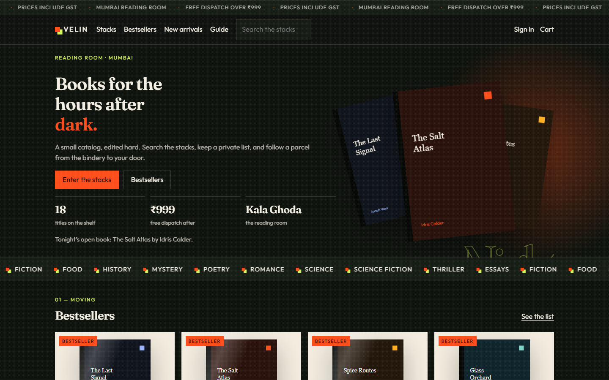 | Home hero |
| 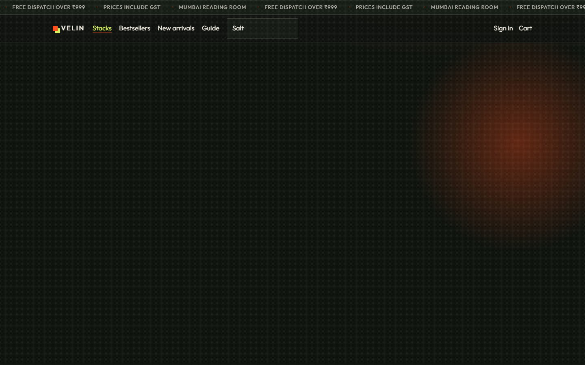 | Search “Salt” |
| 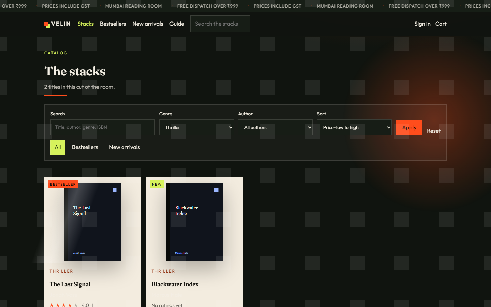 | Thriller + price sort |
| 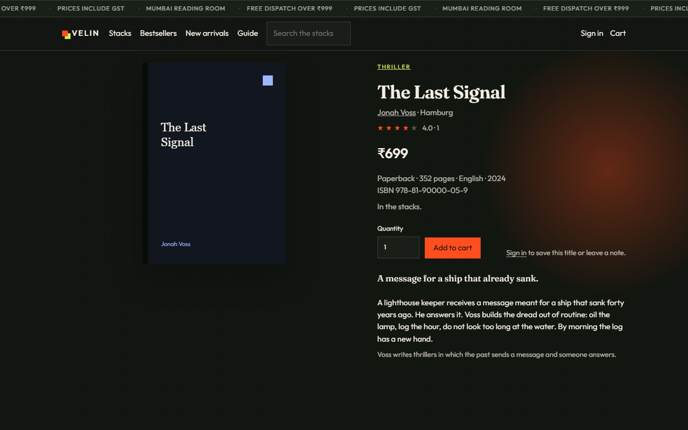 | Book detail |
| 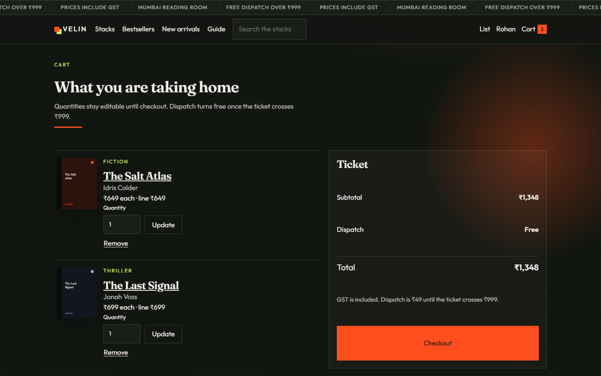 | Cart |
| 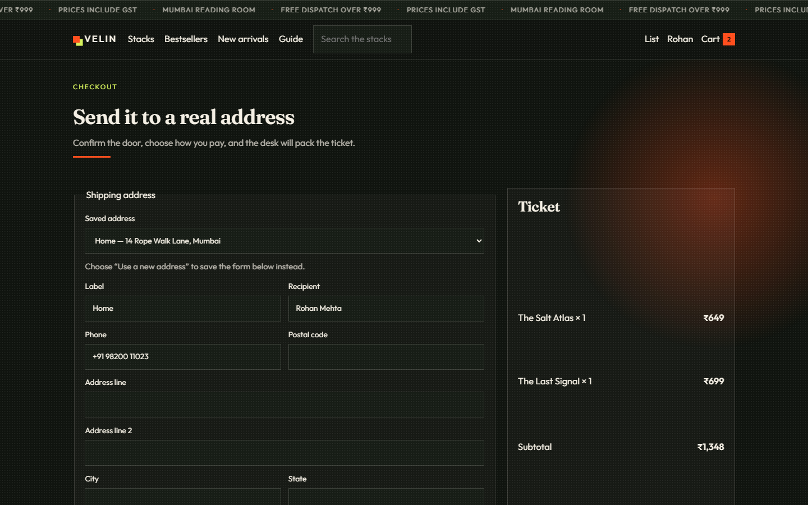 | Checkout |
| 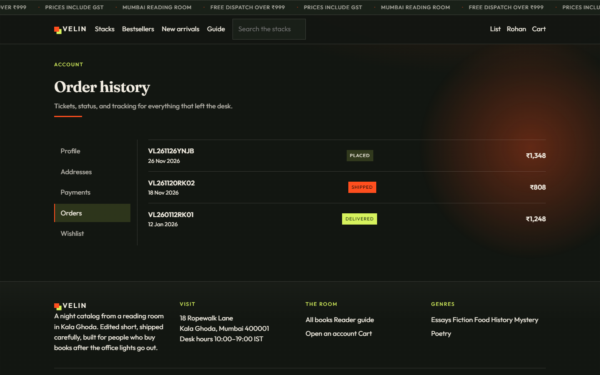 | Order history |
|  | Order timeline |
| 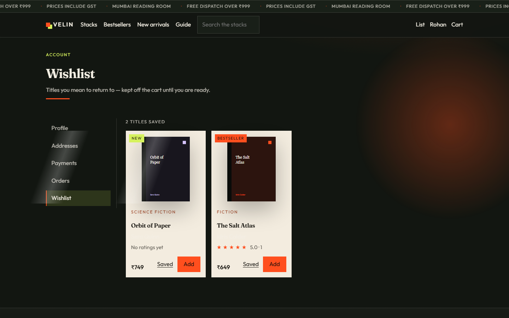 | Wishlist |
| 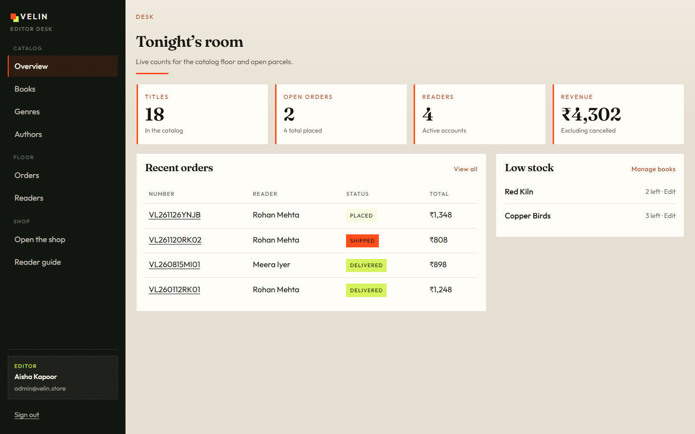 | Admin overview |
| 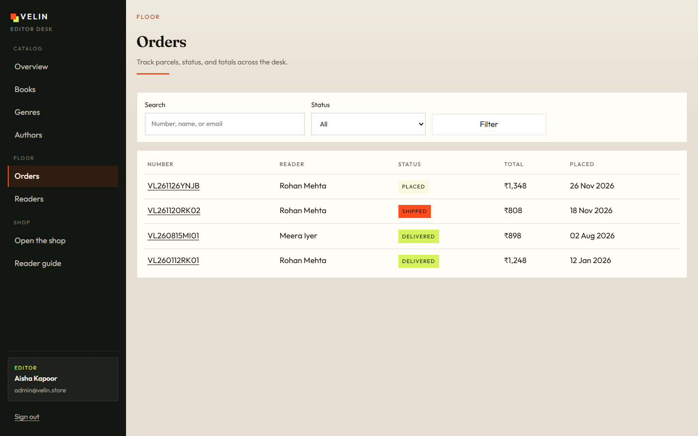 | Admin orders |
| 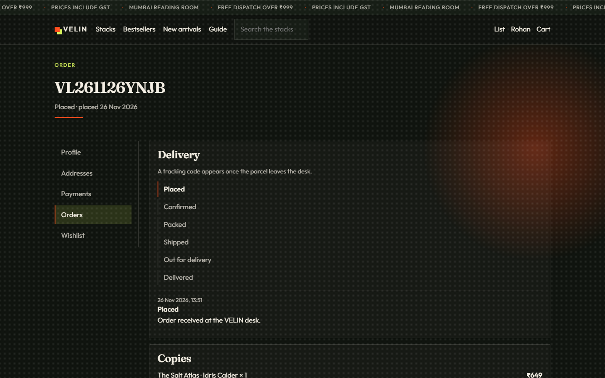 | Reader tracking |

## Where to extend

- Real payment capture: replace `PaymentVault` with a gateway token. Do not add a column for the PAN.
- Real OAuth: install Socialite and redirect from `SocialAuthController` when the client id exists.
- MySQL: set `DB_CONNECTION=mysql` and the usual host variables, then migrate again.
- Mail: set `MAIL_MAILER` to a real transport. The reset mailable is `App\Mail\ResetPasswordMail`.

## Tests

`tests/Feature/BookstoreTest.php` covers search, checkout stock, the card vault, the editor gate, and the local-only social demo. `tests/Unit/MoneyAndCardTest.php` covers Luhn and the dispatch threshold. Run `php artisan test`.

## Walkthrough video checklist

The recording in `docs/video/velin-walkthrough.webm` follows the brief:

1. Home, search “Salt”, filter Thriller, sort by price
2. Open a book, add to cart, save to wishlist
3. Sign in as `reader@velin.store`, checkout
4. Open the order timeline
5. Reviews on The Salt Atlas
6. Admin desk: order shipped with tracking
7. Reader sees tracking on the order
